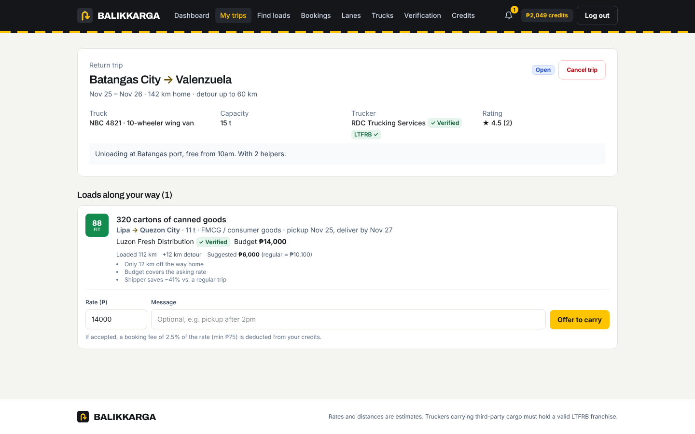

# BalikKarga

**Backhaul load marketplace for the Philippines.** Trucks that deliver cargo often drive home empty.
BalikKarga lets truckers post the empty return leg and matches it with shippers' loads along the way.
Shippers pay a discounted backhaul rate, and truckers earn on kilometers they would have driven anyway.



## What the MVP does

| Role | Can do |
| --- | --- |
| **Trucker / operator** | Register trucks (plate, type, capacity, LTFRB franchise no.) · post return trips (empty at → heading home, dates, max detour, asking rate) · see ranked loads along the way · offer on loads · accept requests · mark picked up / delivered with proof of delivery |
| **Shipper** | Post loads (cargo type, weight, truck type, pickup/drop-off, dates, budget) · see trucks already heading that way with a fit score and suggested price · request a truck · accept trucker offers · rate the trucker after delivery |
| **Admin** | Verify users and truck franchises · see GMV, platform fees, empty km filled and CO₂ avoided |

### Trucker credits and booking fees
- Truckers keep a prepaid **credit balance**, where 1 credit = ₱1.
- **Top-up:** the trucker sends money by GCash, Maya or bank transfer, then submits the amount, the reference number and an optional receipt screenshot. An admin checks the payment and approves it, and the credits are added. Duplicate reference numbers are rejected.
- **Booking fee:** when both sides agree and a booking is accepted, the fee is deducted from the trucker's credits. The fee is 2.5% of the agreed rate, minimum ₱75, and is set in `src/lib/constants.ts`. **Phone numbers are revealed only after this.**
- **Not enough credits:**
  - a trucker can't send an offer or accept a request
  - if a shipper tries to accept an offer, the trucker is told to top up
- **Refunds:** if the shipper cancels an accepted booking, the fee is refunded. If the trucker cancels, the fee is kept.
- **Welcome bonus:** new truckers get **₱300 free credits**, enough to cover their first booking fees.
  - The bonus is reserved at sign-up and **credited once these documents are approved:**
    - government ID
    - driver's license
    - OR/CR and LTFRB franchise for at least one truck

    The last approval also marks the account Verified. DTI/SEC or BIR 2303 is optional for the bonus.
  - Truckers see what's still missing on their Credits and Verification pages.
  - One bonus per mobile number: `0917…` and `+63917…` count as the same number.
  - Change the amount, or set it to 0 to turn the promo off, with `SIGNUP_BONUS` in `.env`.
- Every change is recorded in a ledger shown on the trucker's **Credits** page.

### Verification documents
- Users upload documents as photos or PDFs (max 5 MB, file type checked from the content):
  - **everyone:** government ID, plus DTI/SEC or BIR 2303
  - **truckers:** driver's license
  - **per truck:** OR/CR and LTFRB franchise (CPC)
- Admins open each file and approve or reject it, with an optional note.
- Approving a CPC marks that truck as **LTFRB-verified**.
- Files can be opened only by their owner and admins.

### SMS alerts (Semaphore)
- Important events are texted to the user: requests, confirmations, pickup, delivery, top-up approvals and lane matches. Each text is one 160-character SMS with a link back to the app.
- Users can turn SMS off from their dashboard.
- **Test mode:** without `SEMAPHORE_API_KEY`, messages aren't sent. They're logged on the admin page instead.

### Saved lanes and match alerts
- **Truckers** save routes their trucks often drive home empty, such as Batangas → Valenzuela. They're alerted when a new load fits.
- **Shippers** save routes they ship often. They're alerted when a truck heading that way posts a return trip.
- Lanes use the same matching engine as everything else.

### Photo proof of delivery
- **At pickup:** the driver can attach photos (optional).
- **At delivery:** at least one photo of the signed DR/waybill or unloaded cargo is required, plus the receiver's name. On phones, the camera opens directly.
- Only the shipper, the trucker and admins can see the photos.

### Also included
- **Notifications inbox.** All events go through `src/lib/notify.ts`, which sends the SMS too.

### Brand: Road Line
- **Colours:** asphalt `#14161A`, lane yellow `#FFC400` and concrete `#F4F4F1`, plus go green `#138A4E` and signal blue `#2F6BFF` for statuses.
- **Fonts:** Archivo for headings and Inter for text, both self-hosted from npm, so builds never download fonts.
- **Logo:** a yellow U-turn lane on asphalt (`src/components/Logo.tsx`, with the same paths in `src/app/icon.svg` and `public/favicon.svg`).
- **Theme tokens:** in `src/app/globals.css`, shared by every page. The landing page (`src/lib/landing.ts`) sets the same colours in its own `:root` block.
- **Rule:** text on yellow is always asphalt. Yellow is never used as text on white; use `brand-700` (dark amber) instead.

### How matching works (`src/lib/matching.ts`)
A load fits a return trip when **all** of these hold:
- the detour is within the trucker's limit
- the weight is within the truck's capacity
- the truck type is compatible (cold chain cargo needs a reefer, and a wing van can take a 6-wheeler load)
- the dates overlap

Each eligible pair gets a 0–100 score:
- penalised by detour, unused capacity, budget below the asking rate, and extra RoRo crossings
- the **suggested backhaul rate** is 60% of an estimated regular rate (per-km by truck class, with a minimum fare), plus the RoRo fee in full when the cargo crosses water

Distances are estimated road km between 68 PH logistics hubs. Rates in `src/lib/constants.ts` are placeholders, so tune them with real lane data.

## Try it in your browser (no install)

On the GitHub repo page, click **Code → Codespaces → Create codespace on main**.
Setup takes about 2–3 minutes the first time: it installs dependencies, creates the database and loads demo data.
The app then opens in a new tab. If it doesn't, open the **Ports** tab and click the globe icon next to port 3000.

## Run it locally

Requires Node 20+.

```bash
cp .env.example .env
npm install
npm run db:reset   # creates the SQLite DB and loads demo data
npm run dev        # http://localhost:3000
```

Demo logins (password `demo1234`): `shipper@demo.ph`, `trucker@demo.ph`, `admin@demo.ph`.
Other seeded accounts: `cebu.hardware@demo.ph`, `davao.coop@demo.ph`, `ricemill@demo.ph`, `bisaya@demo.ph`, `coldx@demo.ph`, `ilocos@demo.ph`.

## Tests

```bash
npm test              # unit tests: matching, pricing, fees, booking rules, bonus rules
npm run typecheck     # TypeScript check
npm run test:e2e      # browser tests of every user flow (about 1 minute)
npm run test:all      # all three, in order. Run this before merging any change.
```

The browser tests (`e2e/`) build the app and run it on port 3100 with **their own database** (`prisma/e2e.db`) and upload folder, so your demo data isn't touched. SMS always stay in test mode. They cover:
- **core flows:** posting, matching, offers and requests, accept, pickup, delivery with photo, rating, sign-up, mobile layout
- **access control:** log-in required, role-only pages, people can't open others' bookings, loads or files
- **credits:** top-ups and admin approval, duplicate references, the 2.5% / ₱75 booking fee, refunds, contacts hidden until accepted
- **documents and photos:** fake files rejected, admin review, franchise verification, private delivery photos
- **alerts:** saved-lane alerts, SMS test log, SMS opt-out
- **welcome bonus:** held until documents are approved, one per mobile number, truckers only

**First time on a new machine or Codespace:** run `npm run test:e2e:setup` once to download the test browser.

## Settings (`.env`)

| Variable | What it does |
| --- | --- |
| `DATABASE_URL` | Database connection |
| `UPLOAD_DIR` | Where uploaded files are stored (default `./uploads`) |
| `SEMAPHORE_API_KEY`, `SEMAPHORE_SENDER_NAME` | Turn on real SMS. Get a key at semaphore.co. The sender name must be approved by Semaphore. |
| `APP_URL` | Your public URL, used in SMS links |
| `SIGNUP_BONUS` | Welcome credits for new truckers (default 300; 0 = off) |
| `NEXT_PUBLIC_PAY_GCASH`, `NEXT_PUBLIC_PAY_MAYA`, `NEXT_PUBLIC_PAY_BANK` | The accounts truckers pay into for top-ups, shown on the Credits page |

## Deploy (Vercel + Supabase), about 15 minutes

1. Create a free project at **supabase.com** and copy the *Session pooler* connection string (Project Settings → Database).
2. In `prisma/schema.prisma`, change `provider = "sqlite"` to `provider = "postgresql"` and commit.
3. Locally, set `DATABASE_URL` to the Supabase string and run `npx prisma db push`. Optionally run `npm run db:seed` for demo data.
4. At **vercel.com**, import this GitHub repo and add the `DATABASE_URL` environment variable. Deploy.
5. Before real users: remove the demo accounts (or don't seed), and change the admin password.

> **Uploads on Vercel.** Vercel's disk isn't permanent, so uploaded documents and photos would disappear. Before going live there, switch `src/lib/storage.ts` to Supabase Storage or S3. Only `putBytes` and `getBytes` need to change.
> This isn't needed on a regular server or VPS, where local disk works.

## Tech
- Next.js 15 (App Router, server actions)
- Prisma (SQLite locally, Postgres in production)
- Tailwind CSS 4
- Zod for validation
- Session-cookie auth with bcrypt-hashed passwords
- Vitest for unit tests
- Landing page (`/`): plain HTML built in `src/lib/landing.ts` and served by `src/app/route.ts`, styled with the
  design-taste-frontend kit in `public/assets` (see `.claude/skills/design-taste-frontend`). Signed-in users are
  redirected to `/dashboard`; the live trip list and delivery figures come from the database.

## Not in the MVP yet (suggested next steps)
- **Automatic top-ups.** Use the PayMongo or Xendit GCash/Maya checkout so credits are added instantly, with no admin step.
- **Payments for the freight itself.** Escrow between shipper and trucker, plus faster payouts.
- **Supabase Storage for uploads.** Needed for Vercel.
- **Viber Business Messages.** As an alternative to SMS.
- **Live GPS tracking.**
- **Real road distances and toll and truck-ban windows.** Google Routes or OSRM, plus MMDA truck-ban windows.
- **Recurring lanes and saved searches**, with alerts when a match appears.
- **Password reset and phone OTP login.**
- **BIR-compliant invoicing and waybill generation.**
